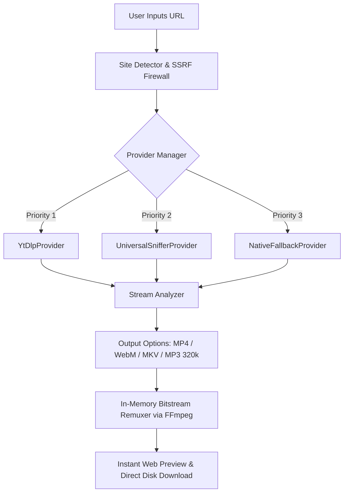

# AnyFormat — Universal Media Stream Downloader

<p align="center">
  
  
  
  
  
</p>

<p align="center">
  <strong>Universal media stream extractor and bitstream remuxer for arbitrary web video & audio.</strong><br />
  Direct 4K/HD video and isolated 320k MP3 extraction with zero quality loss, no accounts, and zero watermarks.
</p>

---

## ⚡ Highlights

- **Universal Platform Coverage**: Instant extraction from stock libraries (**Mixkit**, **Pixabay**), social video (**Instagram Reels**, **TikTok**, **Reddit**, **X**), and streaming hubs (**YouTube**, **Vimeo**).
- **Native Bitstream Remuxing**: Direct FFmpeg packaging (`-c copy`) preserves original stream bitrates without lossy re-compression.
- **Studio Equalizer Workbench**: Real-time tactile UI with a live 5-bar VU meter, 1-click test presets, and direct in-browser video/audio previews.
- **Zero-Lag Moving Backdrop**: GPU-composited continuous stream flow (`translate3d`) with 0% CPU overhead, zero layout shifts, and full mobile optimization.
- **100% Private & Free**: Operates with zero user logs, no authentication walls, and no intrusive watermarks.

---

## 🚀 Quick Start

### 1. Prerequisites
Ensure you have **Node.js 18+** installed along with **FFmpeg** and **Python 3** (required for `yt-dlp` stream extraction):

```bash
# Verify system dependencies
ffmpeg -version
python --version
node -v
```

### 2. Installation & Setup

```bash
# Clone the repository
git clone https://github.com/SajunPalraj/Any-Format.git
cd Any-Format

# Install project dependencies
npm install

# Start development server
npm run dev
```

Open [http://localhost:3000](http://localhost:3000) in your browser.

---

## 🛠 Supported Stream Pipelines

<details open>
<summary><strong>Click to view Supported Platforms & Codecs</strong></summary>

| Platform | Category | Output Qualities | Bitstream Pipeline |
| :--- | :--- | :--- | :--- |
| **Mixkit** | Stock Video | Up to 4K / 1080p | Direct origin MP4 pass-through |
| **Pixabay** | Royalty-Free Media | 4K / 1080p / 720p | Anti-bot bypass (`impersonate`) + MP4 remux |
| **YouTube** | Video & Audio Streams | Up to 4K 60fps / MP3 320k | Adaptive DASH video/audio demuxing & merge |
| **Instagram** | Reels & Posts | Clean 1080p stream | Direct CDN stream extraction |
| **TikTok** | Short Clips & Audio | Original source quality | Clean watermark-free source capture |
| **Reddit** | Hosted Video (`v.redd.it`) | Native source resolution | DASH separate audio/video muxing |
| **Vimeo** | Pro Video | 1080p / 720p HLS | Master playlist demuxing |
| **X (Twitter)** | Broadcast Clips | Highest MP4 bitrate | Direct video stitch |
| **Arbitrary Web** | HTML5 / JSON-LD / HLS | Origin stream spec | Universal DOM sniffer + FFmpeg direct copy |

</details>

---

## 📐 Architecture & Flow



---

## 📡 API Reference

<details>
<summary><strong>1. Inspect / Analyze Stream (GET <code>/api/download</code>)</strong></summary>

Inspects a media link and returns resolution tiers, duration, thumbnail, and stream manifest.

```http
GET /api/download?url=https://mixkit.co/...&analyze=true
```

**Response (200 OK):**
```json
{
  "success": true,
  "supported": true,
  "jobId": "job-1712000000000",
  "title": "Tunnel of Futuristic Neon Lights",
  "uploader": "Mixkit",
  "duration": "00:15",
  "platform": "Mixkit",
  "thumbnail": "https://assets.mixkit.co/...",
  "qualityOptions": [
    {
      "id": "best",
      "quality": "1080p",
      "extension": "mp4",
      "formatNote": "HD Original"
    }
  ]
}
```

</details>

<details>
<summary><strong>2. Extract & Convert Stream (POST <code>/api/download</code>)</strong></summary>

Executes in-memory demuxing and returns download and preview URLs.

```http
POST /api/download
Content-Type: application/json

{
  "url": "https://pixabay.com/videos/...",
  "format": "mp4",
  "quality": "1080p"
}
```

**Response (200 OK):**
```json
{
  "success": true,
  "jobId": "job-1712000000000",
  "downloadUrl": "/api/jobs/job-1712000000000/output?download=1",
  "previewUrl": "/api/jobs/job-1712000000000/output",
  "mimeType": "video/mp4",
  "resolution": "1920x1080"
}
```

</details>

---

## 🛡 Security & Privacy Standards

- **SSRF Hardening**: All extraction requests validate hostnames against private IP CIDR ranges (RFC 1918) and loopback addresses.
- **Zero Log Retention**: Processing runs in memory and scratch temp paths that purge automatically upon job completion.
- **No Third-Party Analytics**: No Google Analytics, tracking pixels, or fingerprinting scripts.

---

## 📄 License

Distributed under the **MIT License**. See [LICENSE](LICENSE) for details.
